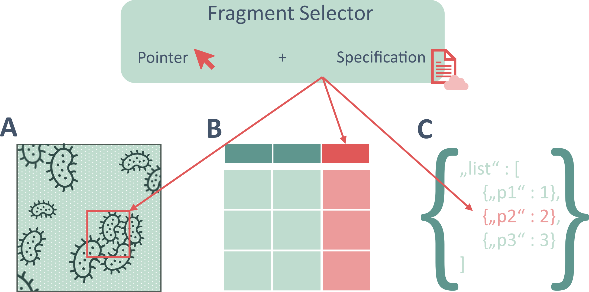
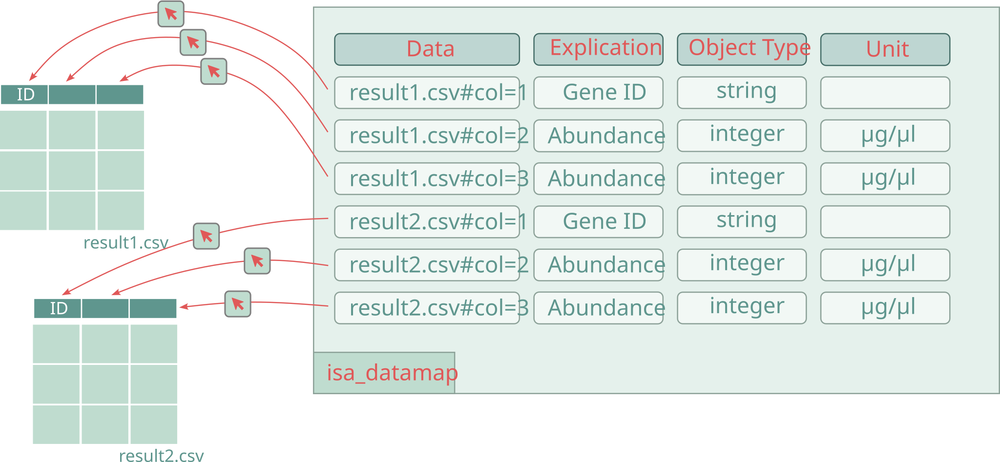
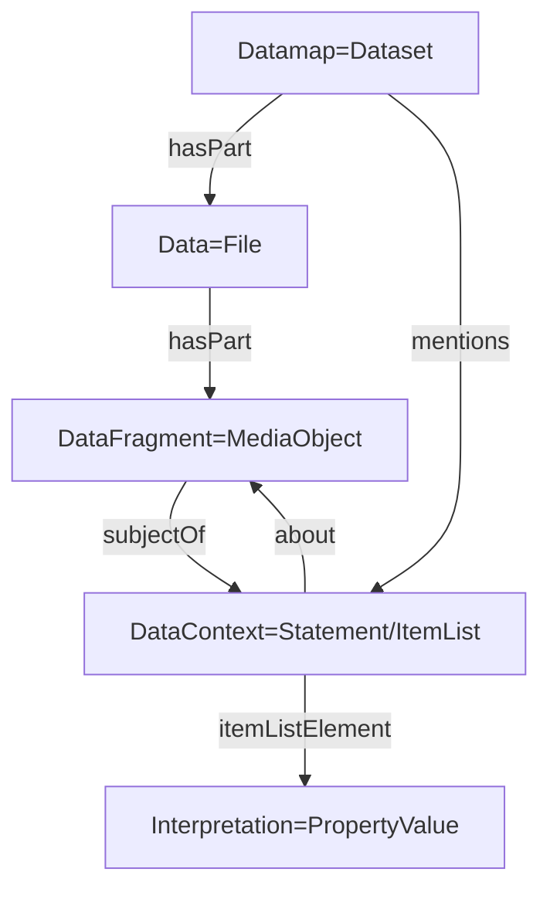

# ARC Datamap RO-Crate profile

* Version: 0.1
* Permalink: <https://w3id.org/arc/ro-crate/datamap/0.1>
* Authors: [ARC RO-Crate community](https://nfdi4plants.github.io/arc-ro-crate-profile/#authors)
* License: [MIT License](https://mit-license.org/)
* Example conforming crate: [ro-crate-metadata.json](https://nfdi4plants.github.io/arc-ro-crate-profile/examples/datamap/ro-crate-metadata.json)
* Profile Crate: [ro-crate-metadata.json](ro-crate-metadata.json)
* Extends:
  - [RO-Crate 1.2 specification](https://w3id.org/ro/crate/1.2)
* JSON-LD context: <https://www.researchobject.org/ro-terms/arc/context.jsonld>
* Vocabulary terms:  <https://w3id.org/ro/terms/arc#>

* **Table of contents**
  * [Overview](#overview)
  * [Detailed Description](#detailed-description)
  * [Example ro-crate-metadata.json](#example-metadata-file-ro-crate-metadatajson)
  * [Requirements](#requirements)
    * [Dataset](#dataset)
    * [Data File](#data-file)
    * [Data Fragment](#data-fragment)
    * [Fragment Descriptor](#fragment-descriptor)
    * [Descriptor Item](#descriptor-item)


## Overview

This profile is an instantiation of the [Semantic Core](../semantic-core/index.md) profile, intended to represent the ARC datamap in the RO-Crate.
The datamap contains contextual information for fragments within data files.
Hence, these contextual information is represented as [interpretations](../semantic-core/index.md#descriptor-item) for the corresponding data entities.

To model data *fragments*, this profile extends the existing hierarchy at the bottom using the same mechanisms as in the normal RO-Crate data model:
Data files are already referenced in their respective datasets through `hasPart`.
Fragments are of type `MediaObject` (equivalent to `File`) and referenced by their parent file or fragment through `hasPart`.



We add the contextual information per entry in the datamap to the `Dataset` objects, conforming with the [Semantic Core Profile](../semantic-core/index.md).
Accordingly, the fragments and their information then reference each other.



See our peer-reviewed publication for more information on the datamap and its usage: [Fragment-level FAIRness](https://doi.org/10.1515/jib-2025-0052)

## Detailed Description

We use `MediaObject` for data fragments and annotate them through descriptor objects for external metadata as described in the [Semantic Core Profile](../semantic-core/index.md). Both objects reference each other. The `Dataset` object lists all datamap entries. Specifically, we plan the following:
- Each data fragment becomes an object of type `MediaObject` with the `additionalType` `DataFragment`, referenced from its file object through `hasPart`.
- Each entry of the datamap becomes a semantic descriptor of type `ItemList` and `Statement` with the `additionalType` `DataContext`, which references a descriptor item in the form of a `PropertyValue` object through `itemListElement`.
- Each of these descriptors becomes one entry in `mentions` of the `Dataset`, which is marked as the datamap through the `additionalType` `Datamap`.
- The data fragments and their descriptors reference each other: the descriptor points to its fragment through `about`, the fragment points back through `subjectOf`.



## Example Metadata File (`ro-crate-metadata.json`)


* [ro-crate-metadata.json](https://nfdi4plants.github.io/arc-ro-crate-profile/examples/datamap/ro-crate-metadata.json)
<!-- * [ro-crate-preview.html](https://nfdi4plants.github.io/arc-ro-crate-profile/examples/datamap/ro-crate-preview.html) -->

```json
{
  "@context": [
    "https://w3id.org/ro/crate/1.2/context",
    {
      "Sample": "https://bioschemas.org/Sample",
      "LabProtocol": "https://bioschemas.org/LabProtocol",
      "LabProcess": "https://bioschemas.org/LabProcess",
      "computationalTool": "https://bioschemas.org/properties/computationalTool",
      "labEquipment": "https://bioschemas.org/properties/labEquipment",
      "reagent": "https://bioschemas.org/properties/reagent",
      "intendedUse": "https://bioschemas.org/properties/intendedUse",
      "executesLabProtocol": "https://bioschemas.org/properties/executesLabProtocol",
      "parameterValue": "https://bioschemas.org/properties/parameterValue",
      "columnIndex": "https://w3id.org/ro/terms/arc#columnIndex"
    }
  ],
  "@graph": [
    {
      "@id": "http://purl.obolibrary.org/obo/NCIT_C45253",
      "@type": "DefinedTerm",
      "name": "string",
      "termCode": "http://purl.obolibrary.org/obo/NCIT_C45253"
    },
    {
      "@id": "processed_data.csv#col=1",
      "@type": "File",
      "additionalType": "DataFragment",
      "name": "processed_data.csv#col=1",
      "encodingFormat": "text/csv",
      "usageInfo": "https://datatracker.ietf.org/doc/html/rfc7111",
      "pattern": {
        "@id": "http://purl.obolibrary.org/obo/NCIT_C45253"
      },
      "subjectOf": {
        "@id": "#Descriptor_processed_data.csv#col=1"
      }
    },
    {
      "@id": "http://purl.obolibrary.org/obo/NCIT_C48150",
      "@type": "DefinedTerm",
      "name": "float",
      "termCode": "http://purl.obolibrary.org/obo/NCIT_C48150"
    },
    {
      "@id": "processed_data.csv#col=2",
      "@type": "File",
      "additionalType": "DataFragment",
      "name": "processed_data.csv#col=2",
      "encodingFormat": "text/csv",
      "usageInfo": "https://datatracker.ietf.org/doc/html/rfc7111",
      "pattern": {
        "@id": "http://purl.obolibrary.org/obo/NCIT_C48150"
      },
      "subjectOf": {
        "@id": "#Descriptor_processed_data.csv#col=2"
      }
    },
    {
      "@id": "processed_data.csv#col=3",
      "@type": "File",
      "additionalType": "DataFragment",
      "name": "processed_data.csv#col=3",
      "encodingFormat": "text/csv",
      "usageInfo": "https://datatracker.ietf.org/doc/html/rfc7111",
      "pattern": {
        "@id": "http://purl.obolibrary.org/obo/NCIT_C48150"
      },
      "subjectOf": {
        "@id": "#Descriptor_processed_data.csv#col=3"
      }
    },
    {
      "@id": "processed_data.csv",
      "@type": "File",
      "name": "processed_data.csv",
      "encodingFormat": "text/csv",
      "hasPart": [
        {
          "@id": "processed_data.csv#col=1"
        },
        {
          "@id": "processed_data.csv#col=2"
        },
        {
          "@id": "processed_data.csv#col=3"
        }
      ]
    },
    {
      "@id": "#Descriptor_processed_data.csv#col=1",
      "@type": [ "Statement", "ItemList" ],
      "additionalType": "DataContext",
      "about": {
        "@id": "processed_data.csv#col=1"
      },
      "itemListElement": [
        { "@id": "#Explication_processed_data.csv#col=1" }
      ]
    },
    {
      "@id": "#Descriptor_processed_data.csv#col=2",
      "@type": [ "Statement", "ItemList" ],
      "additionalType": "DataContext",
      "about": {
        "@id": "processed_data.csv#col=2"
      },
      "itemListElement": [
        { "@id": "#Explication_processed_data.csv#col=2" }
      ]
    },
    {
      "@id": "#Descriptor_processed_data.csv#col=3",
      "@type": [ "Statement", "ItemList" ],
      "additionalType": "DataContext",
      "about": {
        "@id": "processed_data.csv#col=3"
      },
      "itemListElement": [
        { "@id": "#Explication_processed_data.csv#col=3" }
      ]
    },
    {
      "@id": "#Explication_processed_data.csv#col=1",
      "@type": "PropertyValue",
      "additionalType": "Interpretation",
      "name": "Explication",
      "value": "Protein identifier",
      "propertyID": "https://purl.org/nfdi4plants/ontology/dpbo/DPBO_0000111",
      "valueReference": "http://purl.obolibrary.org/obo/NCIT_C165059",
      "alternateName": "protID"
    },
    {
      "@id": "#Explication_processed_data.csv#col=2",
      "@type": "PropertyValue",
      "additionalType": "Interpretation",
      "name": "Explication",
      "value": "molecule count",
      "propertyID": "https://purl.org/nfdi4plants/ontology/dpbo/DPBO_0000111",
      "unitCode": "http://purl.obolibrary.org/obo/NCIT_C68892",
      "unitText": "Millimole per Kilogram",
      "valueReference": "http://purl.obolibrary.org/obo/UO_0000192",
      "alternateName": "quant1"
    },
    {
      "@id": "#Explication_processed_data.csv#col=3",
      "@type": "PropertyValue",
      "additionalType": "Interpretation",
      "name": "Explication",
      "value": "molecule count",
      "propertyID": "https://purl.org/nfdi4plants/ontology/dpbo/DPBO_0000111",
      "unitCode": "http://purl.obolibrary.org/obo/NCIT_C68892",
      "unitText": "Millimole per Kilogram",
      "valueReference": "http://purl.obolibrary.org/obo/UO_0000192",
      "alternateName": "quant2"
    },
    {
      "@id": "https://w3id.org/arc/ro-crate/datamap/0.1",
      "@type": [
        "CreativeWork",
        "Profile"
      ],
      "name": "Datamap Crate Profile",
      "version": "0.1"
    },
    {
      "@id": "LICENSE",
      "@type": "CreativeWork",
      "text": "ALL RIGHTS RESERVED BY THE AUTHORS"
    },
    {
      "@id": "./",
      "@type": "Dataset",
      "additionalType": "Datamap",
      "description": "An example of a ROCrate with a datamap, including annotation of a tabular data file.",
      "name": "ARC Datamap Crate Example",
      "datePublished": "2026-11-25T00:08:52.9459491",
      "hasPart": {
        "@id": "processed_data.csv"
      },
      "mentions": [
        {
          "@id": "#Descriptor_processed_data.csv#col=1"
        },
        {
          "@id": "#Descriptor_processed_data.csv#col=2"
        },
        {
          "@id": "#Descriptor_processed_data.csv#col=3"
        }
      ],
      "conformsTo": {
        "@id": "https://w3id.org/arc/ro-crate/datamap/0.1"
      },
      "dateCreated": "2026-11-25T00:08:52.9504303",
      "license": {
        "@id": "LICENSE"
      }
    },
    {
      "@id": "ro-crate-metadata.json",
      "@type": "CreativeWork",
      "conformsTo": {
        "@id": "https://w3id.org/ro/crate/1.2"
      },
      "about": {
        "@id": "./"
      }
    }
  ]
}
```

## Requirements

### Dataset

Object containing and annotating data files and fragments. In the context of this profile, this object is used to represent the datamap and its entries.

| Property | Required | Expected Type | Description |
|----------|----------|---------------|-------------|
|@type |MUST|[Text](https://schema.org/Text)|Must be '[schema.org/Dataset](https://schema.org/Dataset)'|
|@id|MUST|[Text](https://schema.org/Text) or [URL](https://schema.org/URL)|Should be a subdirectory corresponding to this dataset.|
|additionalType|SHOULD|[Text](https://schema.org/Text)|Should contain `"Datamap"`, marking the dataset as a datamap. If the dataset carries another marker as well, such as `"Assay"` from the [ISA profile](../isa/index.md), `additionalType` holds both values.|
|hasPart|SHOULD|[File](https://schema.org/MediaObject)|The data files resulting from the processes performed in this dataset.|
|mentions|SHOULD|[schema.org/Statement](https://schema.org/Statement) and [schema.org/ItemList](https://schema.org/ItemList)|The entries of the datamap, each as a fragment descriptor following the [fragment descriptor profile](#fragment-descriptor).|


### Data (File)

Describes and points to a Data file.

| Property | Required | Expected Type | Description |
|----------|----------|---------------|-------------|
|@type |MUST|[Text](https://schema.org/Text)|Must be 'File' or 'MediaObject'|
|@id|MUST|[Text](https://schema.org/Text) or [URL](https://schema.org/URL)|Should be the path pointing to the file./
|name|MUST|[Text](https://schema.org/Text) or [URL](https://schema.org/URL)|The name of the file.|
|comment|COULD|[schema.org/Comment](https://schema.org/Comment)|Comment|
|encodingFormat|COULD|[Text](https://schema.org/Text) or [URL](https://schema.org/URL)|Media format as a MIME type|
|hasPart|COULD|[File](https://schema.org/MediaObject)|The data fragments within this file. They must follow the [Data Fragment profile](#data-fragment).|

### Data Fragment

Describes and points to a *Fragment* of a Data file. In addition to the filepath, the `@id` property must contain a [fragment selector](https://www.w3.org/TR/annotation-model/#selectors)(separated by a `#`) to point to the specific fragment within the file. The specifcation describing the fragment selector should be provided in the `usageInfo` property.

| Property | Required | Expected Type | Description |
|----------|----------|---------------|-------------|
|@type |MUST|[Text](https://schema.org/Text)|Must be 'File' or 'MediaObject'|
|@id|MUST|[Text](https://schema.org/Text) or [URL](https://schema.org/URL)|Should be the path pointing to the file with a [fragment selector](https://www.w3.org/TR/annotation-model/#selectors) attached.|
|additionalType|MUST|[Text](https://schema.org/Text)|Must be `"DataFragment"`, marking the object as a fragment of a data file.|
|usageInfo|MUST|[Text](https://schema.org/Text) or [URL](https://schema.org/URL)|(Formal) Description of the fragment selector.|
|subjectOf|SHOULD|[schema.org/Statement](https://schema.org/Statement) and [schema.org/ItemList](https://schema.org/ItemList)|The fragment descriptor for this fragment. It must follow the [fragment descriptor profile](#fragment-descriptor).|
|pattern|SHOULD|[schema.org/DefinedTerm](https://schema.org/DefinedTerm)|Defines the shape or format of entries in this fragment.|
|name|COULD|[Text](https://schema.org/Text) or [URL](https://schema.org/URL)|The name of the file.|
|comment|COULD|[schema.org/Comment](https://schema.org/Comment)|Comment|
|encodingFormat|COULD|[Text](https://schema.org/Text) or [URL](https://schema.org/URL)|Media format as a MIME type|

### Fragment Descriptor

Adds further annotation to a Data file or a *Fragment* thereof. 

| Property | Required | Expected Type | Description |
|----------|----------|---------------|-------------|
|@type |MUST|[Text](https://schema.org/Text)|Must be `[schema.org/Statement, schema.org/ItemList]`|
|@id|MUST|[Text](https://schema.org/Text) or [URL](https://schema.org/URL)||
|additionalType|MUST|[Text](https://schema.org/Text)|Must be `"DataContext"`, marking the descriptor as an entry of the datamap.|
|about|MUST|[schema.org/MediaObject](https://schema.org/MediaObject)|The described data fragement using a [fragment selector](https://www.w3.org/TR/annotation-model/#selectors), following the [data fragment profile](#data-fragment).|
|itemListElement|MUST|[schema.org/PropertyValue](https://schema.org/PropertyValue)| The descriptor item of the datamap entry. It must follow the [descriptor item profile](#descriptor-item). |

### Descriptor Item

The [descriptor item](../semantic-core/index.md#descriptor-item) of a datamap entry, describing the contents of a data fragment. It is represented as a [PropertyValue](https://schema.org/PropertyValue) object.

| Property | Required | Expected Type | Description |
|----------|----------|---------------|-------------|
|@type |MUST|[Text](https://schema.org/Text)|Must be '[schema.org/PropertyValue](https://schema.org/PropertyValue)'|
|@id|MUST|[Text](https://schema.org/Text) or [URL](https://schema.org/URL)||
|additionalType|SHOULD|[Text](https://schema.org/Text)|Should be `"Interpretation"`, marking the descriptor item as an [interpretation](../semantic-core/index.md#descriptor-item) in the sense of the Semantic Core Profile.|
|name|MUST|[Text](https://schema.org/Text)|Must be `"Explication"`|
|propertyID|MUST|[URL](https://schema.org/URL)|MUST be `"https://purl.org/nfdi4plants/ontology/dpbo/DPBO_0000111"`|
|value|SHOULD|[Text](https://schema.org/Text)|Explication of the data fragment contents|
|valueReference|SHOULD|[URL](https://schema.org/URL)|Value ontology reference|
|unitText|SHOULD|[Text](https://schema.org/Text)|Unit of the data fragment|
|unitCode|SHOULD|[URL](https://schema.org/URL)|Unit ontology reference|
|alternateName|SHOULD|[Text](https://schema.org/Text)|The label of the fragment, e.g. a column header.|
|measurementMethod|SHOULD|[Text](https://schema.org/Text)|Name of the tool used to create the data.|
|description|SHOULD|[Text](https://schema.org/Text)|Can be used to describe further details of the fragment|
